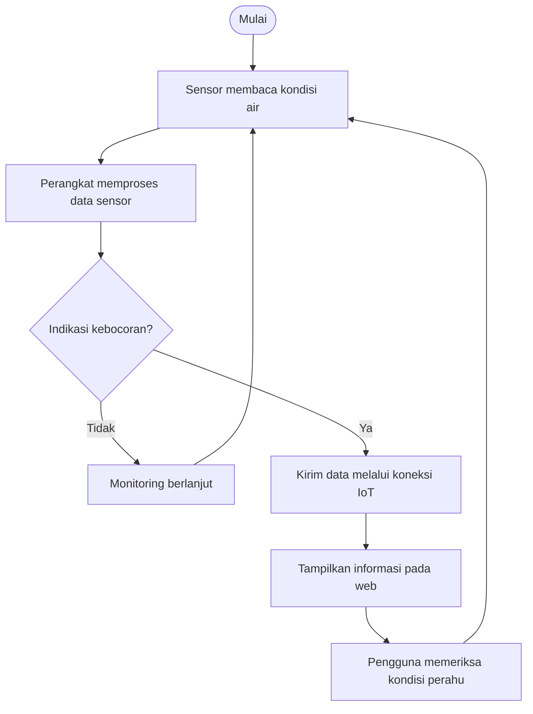

## SeaTection
 
Prototipe IoT untuk membantu mendeteksi potensi kebocoran air pada perahu nelayan.

## 1. Fungsi
- Membaca kondisi melalui sensor pada perangkat.
- Memproses data untuk mengenali indikasi kebocoran.
- Mendukung pemantauan kondisi se4cara realtme.

## 2. Cara Kerja

## 3. Struktur Program
- `Device/` — kode perangkat IoT dan pemrosesan sensor.
- `web/` — komponen antarmuka pemantauan.

